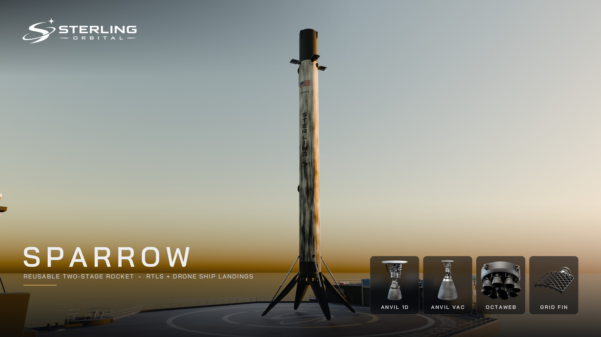
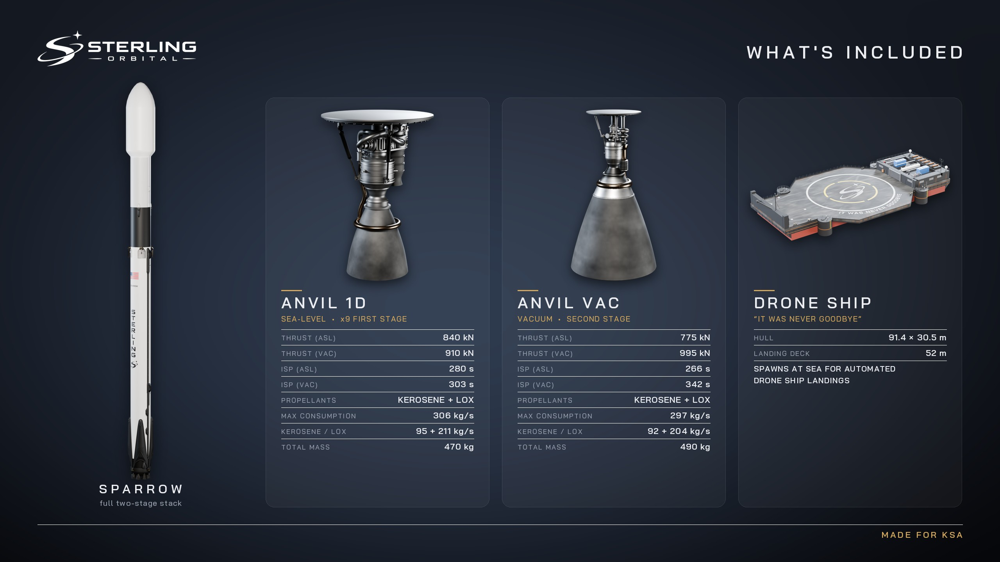
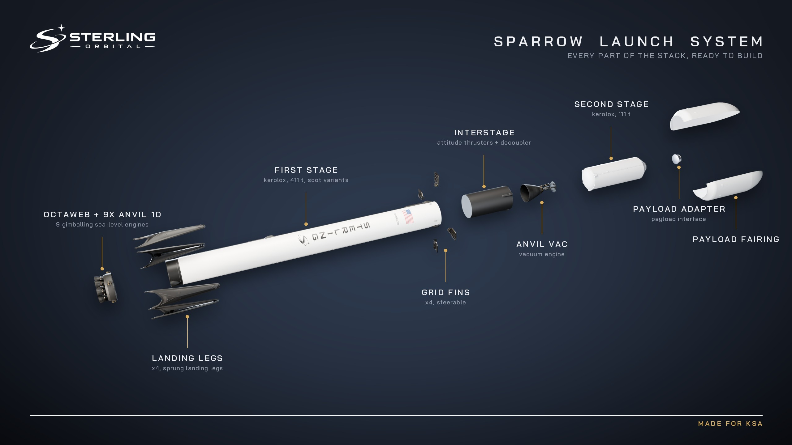

# Sterling Orbital: Sparrow Launch System (v1.0.0)

**[Download the latest release](https://github.com/SterlingOrbital/SterlingOrbital/releases/latest)** (`SterlingOrbital_v1.0.0.zip`)

A reusable two-stage rocket for Kitten Space Agency, with its own engines, a drone ship, and flight software that
flies the whole mission: ascent, staging, and a propulsive landing of the first stage either back at the launch
site (RTLS) or on the drone ship.

## What's included

One mod folder, `SterlingOrbital`, with everything in it:

- **Parts:** first stage (clean and sooted liveries, plain variants), interstage, second stage, payload adapter,
  fairing halves, grid fins, landing legs, the octaweb (9x Anvil 1D) and the Anvil Vac upper-stage engine. 24 attitude
  thrusters are built into the interstage and first stage.
- **Drone ship:** the autonomous drone ship "It Was Never Goodbye", which spawns at sea for drone ship landings.
- **Flight software (code):** mission control panel, launch webcast, booster guidance and landing, grid fin
  aerodynamics, landing leg suspension, engine sets (9 / 3 / 1), soot on the first stage after the entry and landing
  burns.

## Requirements

- Kitten Space Agency, build 2026.11.25.5949 or newer.
- The StarMap mod loader (the flight software is a StarMap mod).

## Install

- **Borea:** install "Sterling Orbital" from the Borea launcher.
- **Manual:** copy the `SterlingOrbital` folder into `Documents\My Games\Kitten Space Agency\mods\`, enable it in
  that folder's `manifest.toml`, and start the game through StarMap.

## Flying a mission

1. Build the Sparrow in the editor: octaweb, first stage, landing legs (4x symmetry) and grid fins (4x symmetry,
   near the top of the first stage), interstage, second stage with the Anvil Vac on its bottom node, payload
   adapter, your payload, fairing halves.
2. Put it on the pad at **KSC (LC-39A)**. Automated flights are KSC-only in this version; other launch sites show a
   notice instead of the LAUNCH button.
3. Open the mission panel from the **Sterling Orbital** menu in the top menu bar (or **Ctrl+Shift+F**). Pick **RTLS** or **DRONESHIP**, set the orbit and inclination (and
   for the drone ship, its distance downrange) by dragging or scrolling the dials, then press **LAUNCH**.
4. Watch it fly. **ABORT** stops the autopilot. F2 or Ctrl+Shift+W leaves the webcast view.
5. When the booster has landed and the upper stage is in orbit, the panel shows **MISSION COMPLETE**. Press
   **RECOVER VEHICLE** to recover the booster (and the drone ship); the panel closes and is ready for the next flight.
   The upper stage stays in orbit.

The panel can be resized with the grip in its bottom-right corner or Ctrl + mouse wheel.

Right-click the octaweb to choose the engine set (9, 3 or 1 engines). The flight software switches sets itself
during the mission.

## Known limitations

- **The guidance system is not perfect, but excitement is guaranteed.**
- Automated flights only from KSC for now.
- First-stage soot is not kept when you reload a save.

## License

- Code (`SterlingFlight.dll` and its source): MIT
- Parts, models, textures, liveries: CC BY 4.0 (see Credits)
- Bai Jamjuree font: SIL Open Font License 1.1

SPDX: `MIT AND CC-BY-4.0`. Full text in `LICENSE`.

Source code: the [`source/SterlingFlight`](source/SterlingFlight) folder of this repository. Build notes are in its README.

## Credits

Sparrow stages, interstage, fairing, grid fins and octaweb are derived from "Falcon 9 - SpaceX" by Stanley Creative
(https://sketchfab.com/3d-models/394f7cf52d124bbd9db69f24d1ff2f08), licensed CC BY 4.0
(https://creativecommons.org/licenses/by/4.0/). Modified: split into game parts, re-meshed, re-textured and
re-branded. Not endorsed by the author.

Bai Jamjuree by Cadson Demak, SIL Open Font License 1.1 (see `Fonts/OFL.txt`).

The Anvil 1D and Anvil Vac engines, the drone ship, the landing legs, the liveries, the Sterling Orbital branding
and all code are original work.

Not affiliated with or endorsed by Space Exploration Technologies Corp.
